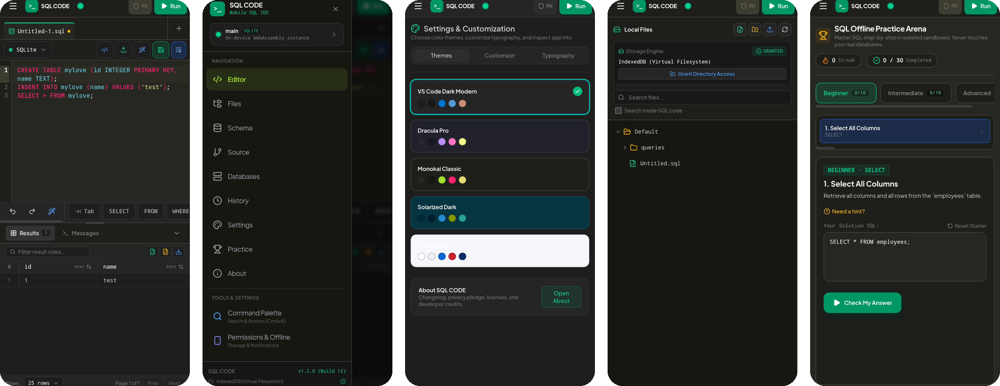

<div align="center">

# SQL CODE

**An offline SQL editor for your phone.**
Write and run real SQL on your device, with no server and no internet.


[**Download the APK**](../../releases/latest) · [**Try it in your browser**](https://sqlcodex.ai.studio) · [Report a bug](../../issues)



</div>

---

## Why SQL CODE?

Most SQL tools need a desktop or a remote database server. SQL CODE puts a real SQLite database engine inside your phone, so you can learn, practice and prototype SQL anywhere, even on a train with no signal.

Your queries, databases and files stay on your device. The app does not collect data or send it anywhere.

## Features

**Editor**
- Live syntax highlighting while you type
- Multiple tabs, with tap-to-rename (`.sql` is added automatically)
- Word wrap, font size controls and pinch to zoom
- Shortcut bar above the keyboard (`Tab`, `SELECT`, `FROM`, `WHERE` and more)
- Schema-aware autocomplete
- SQL formatter, undo and redo

**Real database engine**
- Runs SQLite compiled to WebAssembly ([sql.js](https://github.com/sql-js/sql.js)), fully on-device
- Real results and real error messages, not simulated output
- Databases persist between launches
- Cancel long-running queries

**Results**
- Results grid with filtering and pagination
- Export results (buttons above the grid)
- Messages tab with execution output and errors
- Query history

**Organize and learn**
- Schema explorer and a Databases screen for your local databases
- Files screen with folders and `.sql` files
- Practice mode: step-by-step challenges (Beginner, Intermediate, Advanced) in isolated sandboxes that never touch your real databases

**App experience**
- Left navigation drawer: Editor, Files, Schema, Source, Databases, History, Settings, Practice, About
- Command palette
- Five themes: VS Code Dark Modern, Dracula Pro, Monokai Classic, Solarized Dark, and a light theme
- Edge-to-edge layout with safe-area support
- Installable and fully offline

## Install

### Android (APK)

1. Open the [latest release](../../releases/latest) on your phone.
2. Download the `.apk` file.
3. Open it. If Android asks, allow installing apps from this source (your browser or file manager).
4. Tap **Install**, then open **SQL CODE**.

> The APK is not from the Play Store, so Android will show an "unknown source" prompt. This is normal for apps installed outside the store.

### In the browser (PWA)

Open **https://sqlcodex.ai.studio** in Chrome, tap the menu (⋮), then **Install app** or **Add to Home screen**.

## Quick start

Paste this into a new tab and tap **Run**:

```sql
CREATE TABLE clients (
  id INTEGER PRIMARY KEY,
  name TEXT NOT NULL,
  email TEXT UNIQUE,
  age INTEGER CHECK (age >= 18)
);

INSERT INTO clients (name, email, age) VALUES ('Asha', 'asha@example.com', 24);
INSERT INTO clients (name, email, age) VALUES ('Ravi', 'ravi@example.com', 31);

SELECT * FROM clients;
```

Try inserting a row with `age = 15`. SQLite will reject it with the real `CHECK` constraint error.

## Build from source

You need [Node.js](https://nodejs.org) 20 or newer.

```bash
git clone https://github.com/kundanky/sql-code.git
cd sql-code
npm install
npm run dev        # start the dev server
npm run build      # production build into /dist
```

### Build the Android app (Capacitor)

```bash
npm run build
npx cap add android
npx cap sync android
npx cap open android   # opens Android Studio; use Build > Build APK(s)
```

You can also build the APK in the cloud with GitHub Actions. See `.github/workflows/android.yml` if present in this repository.

## Tech stack

| Area | Tools |
| --- | --- |
| UI | React, TypeScript, Vite, Tailwind CSS |
| Editor | CodeMirror 6 |
| Database | SQLite via sql.js (WebAssembly) |
| Formatting | sql-formatter |
| Version control | isomorphic-git |
| Packaging | Capacitor (Android), PWA with service worker |
| Storage | IndexedDB (virtual filesystem and saved databases) |

## Project layout

```
public/              PWA manifest, service worker, icons
src/components/      UI screens and widgets (editor, results, layout, files, theming...)
src/config/          App info and changelog
src/hooks/           Shared React hooks
src/utils/           SQL engine, storage and helper logic
src/data/            Static data (themes, dialects, practice content)
capacitor.config.ts  Native app configuration
```

## Current limitations

- **Only SQLite runs queries.** The dialect picker (PostgreSQL, MySQL and others) changes syntax highlighting only. There are no remote database connections.
- **File storage:** files are saved in the app's own storage (IndexedDB). Saving to a folder you choose on the phone depends on the browser or the native build.
- **Source tab (Git):** early version. Expect rough edges.
- Android only for now. There is no iOS build.

## Roadmap

- [ ] Full local Git workflow with branches
- [ ] CSV import polish and database file import/export
- [ ] Snippets library
- [ ] Native storage and notification permissions in the Capacitor build
- [ ] Play Store release

## Privacy

All queries, databases and files stay on your device. SQL CODE makes no network calls and collects no data.

## Contributing

Bug reports and ideas are welcome. Open an [issue](../../issues) and include your phone model, Android version and the app version from **About**. Use the **Copy App & System Info** button in About to copy those details.

## License

Released under the [MIT License](LICENSE).

SQL CODE is not affiliated with the owners of PostgreSQL, MySQL, Oracle, SQL Server, MariaDB, MongoDB or any other product named in the dialect picker. Those names are used only to describe syntax highlighting modes.

Built with open-source software, including React, CodeMirror, sql.js, isomorphic-git and Capacitor. Full license texts are in the app under **About > Open Source Licenses**.

## Author

Built by **Kundan Yadav** ([@kundanky](https://github.com/kundanky)).
